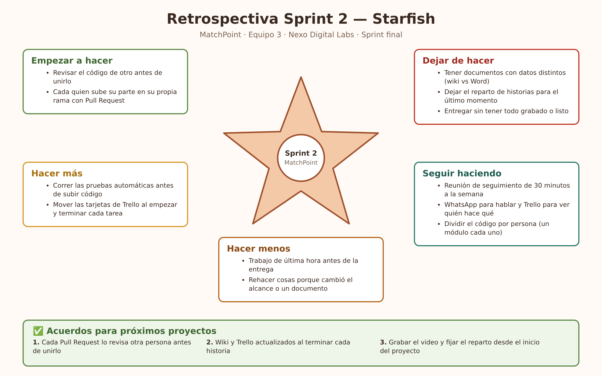

# Retrospectiva del Sprint 2 — Starfish

**Equipo:** Equipo 3 · **Facilita:** Karla Martín (Scrum Master) · **Participan:** Daniel Zuluaga, Dana Quevedo, Sebastián Barreto
**Tablero:** https://trello.com/b/LtNyZnp8/matchpoint (listas «Retro · …»)

**Video de la retrospectiva:** [Retrospectiva-Sprint-2.mp4](Retrospectiva-Sprint-2.mp4)

## 1. Técnicas investigadas

| Técnica | Cómo funciona | Cuándo conviene |
|---|---|---|
| **Starfish (estrella de mar)** | 5 categorías: *Empezar a hacer, Dejar de hacer, Seguir haciendo, Hacer más, Hacer menos*. | Primera retro de un equipo: da más matices que «bien / mal» y es fácil de seguir. |
| **Sailboat (velero)** | Metáfora: la isla es la meta, el viento empuja, las anclas frenan, las rocas son riesgos. | Alinear al equipo con el objetivo; útil al inicio o a mitad del proyecto. |
| **4L** | *Liked, Learned, Lacked, Longed for* (me gustó, aprendí, faltó, deseé). | Cierre de proyecto o de un ciclo largo, para recoger aprendizaje. |

**Elegida: Starfish.** Es el primer sprint con código del equipo; las cinco categorías convierten las ideas en acciones concretas («empezar», «dejar», «más», «menos») sin necesitar una metáfora que explicar.

Fuente de consulta: Retrium, *10 retrospective techniques to try with your agile team* — https://www.retrium.com/blog/10-retrospective-techniques-to-try-with-your-agile-team

## 2. Resultado

| Categoría | Ideas del equipo |
|---|---|
| Seguir haciendo | Reunión de seguimiento de 30 minutos a la semana. WhatsApp para hablar y Trello para ver quién hace qué. Dividir el código por persona (un módulo cada uno). |
| Empezar a hacer | Revisar el código de otro compañero antes de unirlo. Cada quien sube su parte en su propia rama con Pull Request. |
| Dejar de hacer | Tener documentos con datos distintos (wiki vs Word). Dejar el reparto de historias para el último momento. Entregar sin tener todo grabado o listo. |
| Hacer más | Correr las pruebas automáticas antes de subir código. Mover las tarjetas de Trello al empezar y terminar cada tarea. |
| Hacer menos | Trabajo de última hora antes de la entrega. Rehacer cosas porque cambió el alcance o un documento. |

## 3. Acuerdos para próximos proyectos

| # | Acuerdo |
|---|---|
| 1 | Cada Pull Request lo revisa otra persona antes de unirlo. |
| 2 | Wiki y Trello actualizados al terminar cada historia. |
| 3 | Grabar el video y fijar el reparto desde el inicio del proyecto. |
